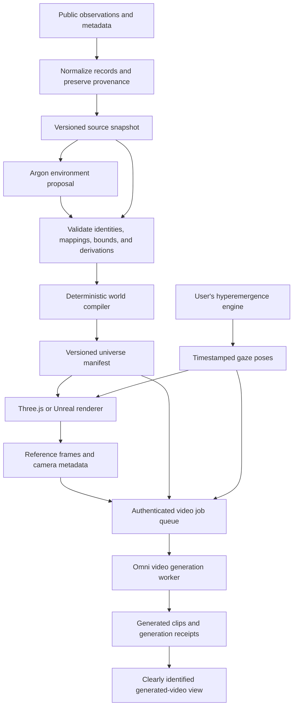

# Planned Gemini integration

Status: design proposal; no Gemini service is deployed by this repository. Model and API references checked against Google's documentation on **25 October 2026**.

Cyberalpine will use Gemini for two jobs: interpreting datasets into an information ecosystem, and generating cinematic segments conditioned on the explorer's gaze. The structured world and its numeric dynamics remain authoritative throughout.

## Current implementation

| Component | Present in this repository | Planned addition |
| --- | --- | --- |
| Environment | Deterministic dataset terrain, source provenance, forests, glaciers, information rivers, and a carved lake | Gemini-assisted semantic composition and validated world proposals |
| Browser | Three.js geometry, materials, reflections, boat inspection, and record lookup | Frame capture, generation controls, and generated-clip presentation |
| Gaze | `window.Cyberalpine.setGaze(...)` and the same-page `cyberalpine:gaze` event | A bridge from the user's hyperemergence engine and timestamped gaze history |
| Video header | A supplied Runway MP4 with playback controls | It remains separate from any future gaze-conditioned generation |
| Unreal | C++ source starter and direct camera-pose boundary | Compiled validation, camera capture, and connection to the model worker |
| Backend | None; Firebase currently hosts static files | Authenticated generation API, queue, worker, artifact storage, and usage controls |

Code entry points: [browser renderer and gaze API](../public/app.js), [world compiler](../unreal/Scripts/build_universe.cjs), and [Unreal gaze pawn](../unreal/Source/CyberquestUnreal/Private/CyberquestGazePawn.cpp).

Robot kinematics and gaze emergence belong to the user's future architecture. Gemini should consume a chosen gaze trajectory; it should not replace that architecture with autonomous camera decisions.

## Model and API choices

| Role | Planned model or API | Intended use |
| --- | --- | --- |
| Environment reasoning | `gemini-4-argon` | Interpret source descriptors, propose ecological organization, and explain the mapping through structured JSON |
| Video generation | `gemini-omni-1.1-flash` | Generate or refine short cinematic segments from rendered references and a gaze/world description |
| Request transport | Gemini Interactions API | Server-side model requests and typed output handling |
| Authentication | Gemini API key held by the backend | Authenticate provider requests through `x-goog-api-key` |

Argon is a model within the Gemini API. Google documents text output, structured outputs, and multimodal input for it; image generation and the Live API are unsupported. We therefore plan to use it as the environment reasoning layer. [Argon model documentation](https://ai.google.dev/gemini-api/docs/models/gemini-4-argon).

Google's current video guide directs Gemini API users to Omni Flash. Veo 3.1 Preview was shut down on 22 October 2026, so its preview identifiers are excluded from this plan. [Video generation guide](https://ai.google.dev/gemini-api/docs/video).

The planned REST endpoint is `POST https://generativelanguage.googleapis.com/v1beta/interactions`. Model identifiers and endpoint version should remain configurable and be checked again when implementation begins. [Interactions overview](https://ai.google.dev/gemini-api/docs/interactions-overview).

## Architecture



Firebase Hosting continues to serve the browser. A proposed Cloud Run service or Firebase Functions service accepts generation jobs; a worker handles provider calls and writes artifacts to access-controlled object storage. This is a deployment proposal, not an existing Firebase rewrite or function. Private boathouses also require a separate identity and entitlement implementation.

## Environment generation with Argon

1. Ingest and normalize source records with the existing fetcher. Preserve record IDs, date precision, units, provider URLs, acquisition times, and snapshot checksums.
2. Assemble a bounded context containing dataset descriptors, computed features, permitted source IDs, and declared transformation edges. Include selected excerpts only when their use is permitted.
3. Ask Argon for a structured proposal: ecosystem interpretation, semantic groupings, material suggestions, and explanations tied to supplied dataset IDs. Mark newly inferred relationships as model interpretations.
4. Validate the proposal against a JSON Schema and application rules. Validate ID membership and semantic consistency as well as syntax. A table still owns a quantitative summit; relational and nested collections still own their declared forest forms. Heights must follow an explicit metric mapping.
5. Apply accepted proposals through the world compiler. Models cannot rewrite source observations, invent missing records, assert new deposited references, or silently alter observed/derived counts.
6. Commit the resulting manifest with the input snapshot hash, model ID, prompt/schema versions, and validation report. Keep the previous valid world available if a proposal fails.

The existing `unreal/Scripts/build_universe.cjs` is the reproducible baseline. Its current output does not incorporate model proposals; adding a validated proposal input is an implementation milestone. Rendering detail must remain separate from terrain geometry used for navigation and force calculations.

Use `response_format` with `type: "text"`, `mime_type: "application/json"`, and an application-owned schema. Schema-constrained generation still requires application validation. [Structured output guide](https://ai.google.dev/gemini-api/docs/structured-output).

See [the illustrative environment request](examples/argon-world-request.json). Its small proposal schema demonstrates the request shape, not the complete future world compiler contract. The server must substitute a bounded context for each actual snapshot and resolve every returned dataset ID.

## Gaze-conditioned video with Omni

The live camera remains a direct view of the structured environment. Generated clips are asynchronous visual interpretations. Model prompts and reference images can guide composition, but they do not guarantee exact camera calibration, landmark placement, or physical consistency.

For each selected segment, the planned capture adapter will record:

- World version, source snapshot hash, and renderer version.
- Monotonic pose timestamps, position, yaw, pitch, and horizontal field of view.
- A rendered reference frame, plus an endpoint frame when available.
- Visible dataset IDs, landscape geometry, weather state, and relevant simulation values.
- The intended duration, visual style, and permitted camera trajectory.

The prompt will request photoreal ice blue, verdant pine, wet granite, archive ice, and physically plausible atmospheric motion. It will identify any generated labels or inferred relationships as interpretation. Numeric forces and source facts always come from the structured simulation.

Omni supports reference-image input and video output through Interactions. The planned initial format is 16:9 at 720p. SDK convenience output and raw REST output have different shapes: direct REST clients must inspect video content in `model_output` steps. [Omni guide](https://ai.google.dev/gemini-api/docs/omni).

See [the illustrative video request](examples/omni-gaze-request.json). Its frame value is a placeholder. Do not send the example unchanged or mistake the example's requested four-second interval for a guaranteed provider output duration; actual output duration must be inspected and reconciled with pose timing.

A proposed job receipt records the input gaze interval, reference-frame hashes, requested settings, actual clip metadata, model, prompt version, provider interaction ID when available, and output checksum. Reject responses for superseded world versions before applying a proposal or presenting a clip as current. If the explorer turns before a segment is ready, the viewer should retain the live renderer and identify the generated segment's original time interval. It should not present stale footage as the current gaze.

## Camera contract

The existing browser input is:

```js
window.Cyberalpine.setGaze({
  position: { x: 45, y: 10, z: -50 },
  yaw: 0,
  pitch: 0,
  fov: 65,
  source: "hyperemergence-engine"
});
```

| Quantity | Browser convention |
| --- | --- |
| Position | Metres; +X east, +Y up, +Z north |
| Yaw | Radians, clockwise from north |
| Pitch | Radians, positive upward |
| `fov` input | Horizontal field of view in degrees |
| `getState().camera.fov` | Three.js vertical field of view; convert before reusing as input |

`setGaze` validates finite values and bounds the effective pose. Store the effective pose returned by the method. It holds the external camera override until a manual view, orbit/zoom, or boat action resumes the preview. The current API does not retain a trajectory, expose frame capture, or provide a network transport; those adapters still need implementation.

For aspect ratio `a`, convert horizontal FOV `h` to vertical FOV with `v = 2 * atan(tan(h / 2) / a)`, using radians during the calculation. The browser already preserves horizontal FOV across resizing.

The Unreal `ACyberquestGazePawn::SetGaze` method accepts `FVector(east, north, height)` in metres, followed by yaw radians, pitch radians, and horizontal FOV degrees. A browser position `(x, y, z)` maps to `FVector(x, z, y)`; the native method handles conversion to Unreal centimetres. The native project remains uncompiled and editor rendering unverified.

Capture must happen immediately after a render or through a dedicated render target. A future capture adapter should not assume a WebGL canvas retains its previous framebuffer indefinitely.

## Server-side configuration and request lifecycle

Suggested names for the future backend:

```dotenv
# Proposed backend configuration; no service currently consumes these values.
GEMINI_API_KEY=<backend-secret>
GEMINI_WORLD_MODEL=gemini-4-argon
GEMINI_VIDEO_MODEL=gemini-omni-1.1-flash
GEMINI_API_BASE_URL=https://generativelanguage.googleapis.com/v1beta
GEMINI_STORE_INTERACTIONS=false
```

Store the key in a backend secret store. Do not put it in `public/`, frontend build variables, browser storage, `.firebaserc`, or Git. Authenticate users at the application API before accepting billed generation jobs. Google's key guidance recommends a backend proxy for production clients. [API-key guide](https://ai.google.dev/gemini-api/docs/api-key).

The proposed first implementation uses an application-owned queue with synchronous provider calls inside a worker and `store: false`. Google documents that `store: false` prevents provider conversation chaining and is incompatible with provider `background: true`; those modes must not be combined. Provider-side background execution can be evaluated separately with an explicit retention decision. [Interactions retention](https://ai.google.dev/gemini-api/docs/interactions-overview#data-storage-and-retention), [background execution](https://ai.google.dev/gemini-api/docs/background-execution).

The application API should return an application job ID and persist job state: queued, running, succeeded, failed, or cancelled. Bound input size, generated-media size, concurrency, queue depth, and per-user usage. Retry quota/transient failures with backoff; do not repeatedly submit unchanged invalid/authentication requests. A client timeout or cancellation must be recorded as an uncertain provider outcome until reconciled, since it may not stop processing or charges.

Retain receipts without secrets or unrestricted raw request/response logging. Generated clips belong in an artifact store with the appropriate collection access policy. Publishing a clip or adding it to the public header should be a deliberate content action, separate from creating the generation job.

## Delivery milestones

1. **Environment adapter:** backend secret loading, configurable models, schema validation, and fixture-based malformed-response tests. Confirm one authorized Argon request and preserve its provenance receipt.
2. **Proposal compiler:** validate source identity, structure-to-landform rules, bounded parameters, missing-data behavior, and preservation of the previous valid world on rejection.
3. **Gaze and capture:** record effective poses and monotonic timestamps; verify FOV conversion, resize behavior, and browser-to-Unreal axis mapping. Add a capture hook and reference-frame checksums.
4. **Video worker:** confirm one authorized reference-frame request, parse both documented response shapes as applicable, validate returned media, and test quota, timeout, cancellation, and duplicate-submission handling.
5. **Viewer:** show generated segments with their original world version and gaze interval. Keep live navigation usable while generation is pending or unavailable.

No Gemini requests or paid generation tests were executed as part of adding this document. Account access, current model availability, pricing, limits, and production service configuration must be verified when the adapter is implemented.
